  <picture>
    <source media="(prefers-color-scheme: dark)" srcset="dark_mode.svg">
    <source media="(prefers-color-scheme: light)" srcset="light_mode.svg">
    
  </picture>

  <picture>
    <source media="(prefers-color-scheme: dark)" srcset="shark/shark-patrol-dark.svg">
    <source media="(prefers-color-scheme: light)" srcset="shark/shark-patrol-light.svg">
    
  </picture>

<!-- Card design inspired by Andrew6rant's neofetch-style profile README.
     Shark patrol graph is generated by shark_patrol.py from my contribution calendar.
     Edit profile_config.json to change the card text. ascii_art_dark.txt and ascii_art_light.txt hold the portrait. -->
