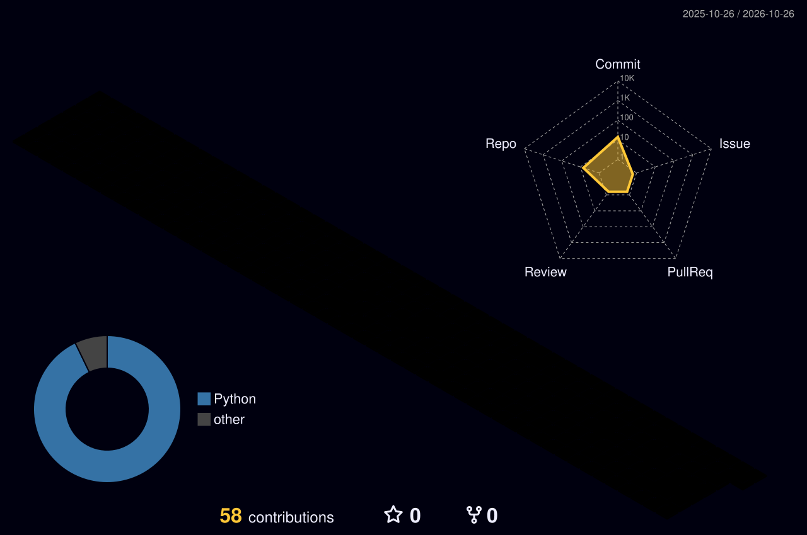

<picture>
  <source media="(prefers-color-scheme: dark)" srcset="dark_mode.svg">
  <source media="(prefers-color-scheme: light)" srcset="light_mode.svg">
  
</picture>

### What I build

Hardware that runs on its own in the field, and the AI that makes it smart.

- **Shark detection on drones (Honours thesis).** YOLO detector tuned to cut missed sharks, especially small, distant ones. Building an on-board edge AI device so the drone detects sharks in real time without streaming video to the ground.
- **Rugged vehicle counter (Micromax industry project).** Battery-powered LoRaWAN field unit built to run unattended for about 8 months. Breadboard to custom KiCad PCB, IP67 enclosure, STM32WLE5 firmware in C sleeping under 2 µA.
- **Autonomous mobile robot (ROS 2).** SLAM + Nav2 maze exploration with return-to-home, beacon search and rescue with depth-based mapping, and line following. Built in Gazebo, then deployed to a real TurtleBot3.
  [Exploration](https://github.com/Gowrishankar-1/ros2-demonstration1) · [Search & rescue](https://github.com/Gowrishankar-1/ros2-search-and-rescue) · [Line follower](https://github.com/Gowrishankar-1/Autonomous_LineFollower)
- **Yuga at Scycle AI.** Multi-model AI workspace where people and AI agents share one context, aimed at automating forward deployed engineering. Built the real-time sync core (TypeScript, WebSockets, 61 passing tests).

### Background

- **Co-founder & CTO, Scycle AI** (iAccelerate, UOW). Lead the technical architecture and signed our first paid deployment contract.
- **Research Assistant, UOW.** Generative AI for computer vision with Prof. Son Lam Phung.
- **Police Inspector, Singapore Police Force (2020–2022).** Trained 500+ recruits and coordinated 40+ trainers. Best Trainee, Best in Professional Studies (Law), Best in Operational Fitness.

### Contribution graph

<picture>
  <source media="(prefers-color-scheme: dark)" srcset="profile-3d-contrib/profile-night-rainbow.svg">
  <source media="(prefers-color-scheme: light)" srcset="profile-3d-contrib/profile-south-season-animate.svg">
  
</picture>

<!-- Card design inspired by Andrew6rant's neofetch-style profile README.
     3D graph by yoshi389111/github-profile-3d-contrib (MIT).
     Edit profile_config.json to change the card text. ascii_art_dark.txt and ascii_art_light.txt hold the portrait. -->
